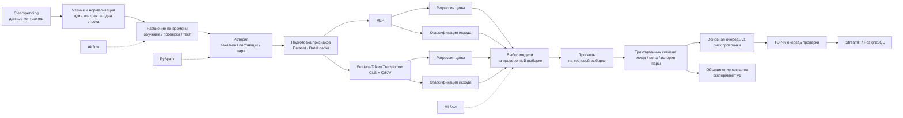

# ProcurePulse

**ProcurePulse — PyTorch-система, которая среди государственных закупок находит контракты с необычной картиной цены, исполнения и истории отношений заказчика с поставщиком. Самые важные случаи попадают в очередь для проверки.**

Один контракт может выделяться высокой ценой, другой — риском просрочки, третий — повторяющимися связями заказчика и поставщика. ProcurePulse помогает увидеть эти различия в большом потоке закупок и понять, **на что обратить внимание в первую очередь**.

В основе — **MLP и Feature-Token Transformer на PyTorch**. Обе модели используют две головы: одна прогнозирует ценовой уровень, другая — вероятность документированной просрочки в течение 365 дней. История заказчика и поставщика добавляет контекст.

**Результат — TOP-N очередь контрактов для проверки**, где видны отдельные сигналы, а не только итоговое число.

## Как работает ProcurePulse



Две головы решают разные задачи. Они обучаются вместе через общее представление, но после получения прогнозов их оценки не усредняются автоматически.

**Важно:** при обучении головы используют общее представление контракта. В готовой очереди их оценки не усредняются автоматически.

## Модели

### MLP

```text
числовые признаки + категориальные эмбеддинги
                      ↓
                общий MLP-блок
                      ↓
             общее представление
                  ↙         ↘
           регрессия цены   классификация исхода
```

MLP использует те же признаки и те же временные границы, что и Transformer. Это базовая модель, с которой сравнивается более сложная архитектура.

### Feature-Token Transformer

```text
числовые проекции + категориальные эмбеддинги
                      ↓
                токены признаков
                      ↓
              [CLS] + внимание
                   Q / K / V
                      ↓
              CLS-представление
                  ↙         ↘
           регрессия цены   классификация исхода
```

Механизм внимания работает между признаками одного контракта, а не между объектами батча.

## Как защищён временной порядок

Текущая цена и сумма контракта не входят в признаки модели.

Наблюдаемая цена служит целью для регрессии цены, а после получения прогноза отдельно используется для расчёта ценового отклонения.

История заказчика, поставщика и их пары строится только по предыдущим датам. Медианы, средние, масштабы и словари категорий считаются только по обучающей выборке.

## Данные

Для полного запуска использованы семь месячных архивов Clearspending за октябрь 2022 — апрель 2023 и московские контракты по 44-ФЗ.

```text
2 187 480 исходных записей
        ↓
168 418 уникальных контрактов Москвы
        ↓
обучение:  115 416
проверка:   25 031
тест:       27 971
```

Источник: [Clearspending Open Data](https://old.clearspending.ru/opendata/). Список файлов, размеры и SHA-256 сохранены в `results/source_files.json`.

## Как строится приоритет проверки

После получения прогнозов сохраняются три сигнала:

```text
outcome_score   — вероятность документированной просрочки
relation_score  — доля прошлых контрактов той же пары
price_score     — положительное отклонение цены от прогноза
```

Основная очередь v1:

```text
audit_priority = outcome_score
```

Фиксированное объединение считается отдельно и остаётся результатом эксперимента:

```text
fusion_baseline = weighted_sum(available signals) / available_weight
weights = 0.60 / 0.25 / 0.15
```

Если какого-то сигнала нет, его вес исключается из расчёта, а не заменяется нулём.

Сумма `price_loss + outcome_loss` во время обучения — другая операция: две задачи вместе обучают общее представление. Это не означает, что их оценки нужно складывать после получения прогноза.

## Запуск

Python 3.12.

```bash
python3.12 -m venv .venv
source .venv/bin/activate
python -m pip install -r requirements.txt
```

Для RTX 5090:

```bash
python -m pip install torch==2.7.1 --index-url https://download.pytorch.org/whl/cu128
```

Для CPU:

```bash
python -m pip install torch==2.7.1 --index-url https://download.pytorch.org/whl/cpu
```

Исходные архивы хранятся в `data/raw/`. При необходимости их можно загрузить отдельно:

```bash
python download_data.py
```

Полный запуск:

```bash
python run.py
```

Отдельные этапы:

```bash
python -m procurepulse.prepare
python -m procurepulse.train
python -m procurepulse.predict
```

Временные границы, параметры обучения и пути находятся в `config.py`.

## Структура проекта

```text
ProcurePulse/
├── models/
│   ├── mlp.py                 # базовая MLP с двумя головами
│   └── transformer.py         # токены признаков + внимание Q/K/V + две головы
├── procurepulse/
│   ├── read_data.py           # архивы → строки контрактов
│   ├── targets.py             # отбор ценовых примеров + целевой исход
│   ├── features.py            # история заказчика / поставщика / пары
│   ├── prepare.py             # разбиение по времени + таблица признаков
│   ├── preprocessing.py       # подготовка признаков по обучающей выборке
│   ├── dataset.py             # тензоры и маски целей
│   ├── engine.py              # обучение и получение прогнозов
│   ├── train.py               # обучение обеих моделей и выбор лучшей
│   ├── metrics.py             # метрики голов и верхней части очереди
│   └── predict.py             # отдельные сигналы + итоговая очередь
├── integrations/
│   ├── postgres.py
│   └── spark.py
├── sql/
├── dags/
├── docs/
│   ├── v1.md                  # гипотеза → проверка → изменение архитектуры
│   └── results.md             # полный набор результатов v1
├── app.py
├── config.py
├── download_data.py
└── run.py
```

Основной путь:

```text
исходные данные
→ строки контрактов и цели
→ разбиение по времени и история
→ подготовка признаков
→ MLP или Transformer
→ выбор модели
→ прогнозы
→ отдельные сигналы
→ приоритет проверки
→ TOP-N очередь
```

## Дополнительный стек

**MLflow** хранит параметры и метрики запусков. **PySpark** повторяет расчёт исторических признаков через оконные функции.

**PostgreSQL/SQL** хранит контракты, признаки и прогнозы. **Airflow** задаёт цепочку `prepare → train → predict`. **Streamlit** показывает очередь и поиск по контрактам.

```bash
streamlit run app.py
python -m integrations.spark
docker compose up -d
python -m integrations.postgres
```

Airflow запускается в отдельном окружении; описание цепочки находится в `dags/procurepulse.py`.

## Что хранится в Git

В репозитории остаются компактные результаты, по которым можно проверить выбор модели и итоговые метрики:

```text
results/selection.json
results/test_metrics.json
results/mlp_history.csv
results/transformer_history.csv
results/source_files.json
```

Полные веса `*.pt`, `queue.csv`, `pairs.csv`, исходные/обработанные данные и хранилище MLflow создаются локально и не коммитятся.

## Версии

### v1 — две головы и проверка объединения сигналов

**Главный результат v1 — изменение архитектуры после эксперимента.**

Изначально предполагалось, что цена, риск просрочки и история пары заказчик–поставщик вместе дадут более сильную очередь, чем один сигнал. На отложенном временном срезе получилось наоборот:

| Способ построения очереди | Precision@100 | Recall@100 | Lift@100 |
|---|---:|---:|---:|
| **Только классификация просрочки** | **0.3000** | **0.0193** | **5.41×** |
| Фиксированное объединение сигналов | 0.2800 | 0.0181 | 5.05× |

Например, контракт может сильно выделяться по цене, но исполняться без просрочки. Другой — иметь обычную цену, но высокий риск просрочки. Механическое объединение частично гасит сильный сигнал слабым.

**После проверки я отказалась от объединённой оценки как основы главной очереди.** Теперь порядок определяет классификация просрочки; ценовое отклонение и история сторон остаются отдельными сигналами. Объединение сохранено для сравнения.

Выбор Transformer по проверочной выборке и результаты на тесте:

| Метрика | Значение |
|---|---:|
| Average Precision по просрочке | **0.1325** |
| ROC-AUC | **0.7260** |
| Lift@100 основной очереди | **5.41×** |

Ценовая голова пока уступила простой медиане по товарной группе по log-MAE: `0.6073` против `0.2330`. Это ещё одна причина не подменять разные сигналы одним числом.

**Подробности:** [путь от гипотезы к решению](docs/v1.md) · [полные результаты и сравнение моделей](docs/results.md).
